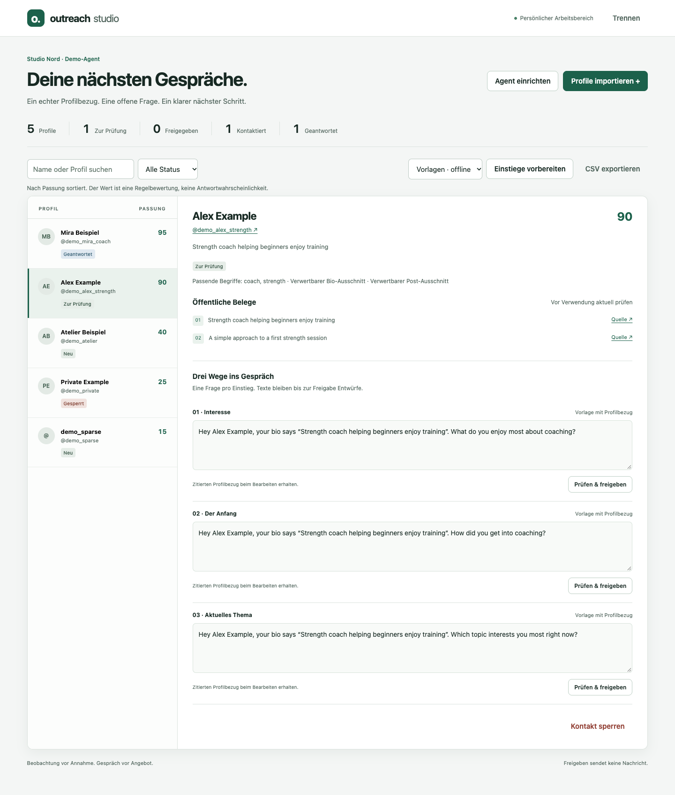

# Outreach Studio

Eine persönliche Arbeitsoberfläche für Instagram-Erstkontakte: Profile importieren, nach Passung sortieren, öffentliche Belege prüfen und passende erste Nachrichten vorbereiten. **Jede Person richtet ihren eigenen Agenten ein**: Name, Rolle, Angebot, Zielgruppe, Sprache, Ton und eigene Einstiegsfragen.

Der Code ist wiederverwendbar; Agenten-Einstellungen, Kontakte und Verlauf liegen in einem getrennten lokalen Datenverzeichnis. Python 3.9 oder neuer genügt. Keine zusätzlichen Python-Pakete, kein Node-Build und keine API-Kosten im Vorlagenmodus.

> **Versandgrenze:** Diese Anwendung sendet keine Instagram-DMs. Die offizielle Meta Send API erlaubt keine beliebigen kalten Erstnachrichten an gefundene Handles. Das System automatisiert Vorbereitung und Nachverfolgung; die Person prüft und versendet den Erstkontakt in Instagram. Siehe [Integrationen](docs/integrations.md).



*Vorschau mit fiktivem Agentenbriefing und Testprofilen.*

## In fünf Minuten starten

```sh
git clone https://github.com/akiotaota-star/instagram-outreach-pipeline.git
cd instagram-outreach-pipeline
./start.sh serve
```

1. Öffne `http://127.0.0.1:8787` und füge den im Terminal angezeigten Zugangsschlüssel ein.
2. Wähle **Agent einrichten**. Trage deine tatsächliche Rolle, dein Angebot und passende Zielkundenbegriffe ein.
3. Wähle **Profile importieren** und lade einen JSON-Profil-Export oder ein vorhandenes Apify-Dataset.
4. Klicke **Einstiege vorbereiten**. Öffne ein Profil, prüfe Belege und drei Textvarianten und gib eine Variante frei.
5. Kopiere den freigegebenen Text, öffne Instagram und sende selbst. Erst danach **Als gesendet markieren**; bei einer Antwort **Antwort erhalten**.

Für einen Test ohne echte Kontakte importiere `examples/profiles.json`. Sämtliche Profile und Posts darin sind **fiktiv**. Die synthetischen Handles/Links sind keine Kontaktziele. Die Datei enthält bewusst private, spärliche und fachfremde Beispiele, um Filter sichtbar zu machen.

`start.sh` legt `.local/data`, `.local/tmp` und `.local/cache` neben dem Repository an und verhindert Python-Bytecode-Dateien. Auf Akis Lexar prüft es vor Schreibzugriffen die hinterlegte Volume-UUID. Diese Verzeichnisse gehören nicht ins Repository. Zum Beenden `Ctrl+C` im Terminal.

### Windows oder direkter Python-Aufruf

PowerShell, nachdem Python installiert ist:

```powershell
$env:PYTHONDONTWRITEBYTECODE = '1'
$env:OUTREACH_DATA_DIR = 'D:\Outreach\data'
python -B -m outreach serve
```

Wähle einen tatsächlichen beschreibbaren Datenpfad. Auf diesem Mac gilt ausschließlich die externe Lexar; nicht in Downloads oder auf die interne SSD klonen.

## Ein eigener Agent pro Person

Die Einrichtung speichert `agent.json` direkt neben `outreach.sqlite3` im Datenverzeichnis. Diese Datei enthält das persönliche Briefing und wird beim nächsten Start wieder geladen. Angepasste Auswahlregeln setzen offene Entwürfe und Freigaben zurück, damit keine Nachricht mit veralteter Zielgruppe verwendet wird. Kontaktierte und gesperrte Personen bleiben erhalten.

Für eine zweite Person verwende eine **andere Installation beziehungsweise ein anderes Datenverzeichnis, einen anderen Zugangsschlüssel und einen anderen Port**. Keine geteilten Kontaktbestände zwischen Kunden. Diese Version ist eine Anwendung für eine Person pro Installation; sie hat keine Teamrollen oder Mandantenverwaltung. [Betrieb und Übergabe](docs/operations.md)

Drei Einstiegskonfigurationen liegen unter `config/`: `general.json`, `coach.json`, `local-services.json`. Ohne Einrichtung startet die allgemeine Vorlage. Für eine neue, noch nicht konfigurierte Installation kann eine andere Vorlage gewählt werden:

```sh
./start.sh --campaign config/coach.json serve
```

Eine bereits gespeicherte `agent.json` hat Vorrang vor dieser Startvorlage. Für einen bewusst neuen Agenten ein neues Datenverzeichnis verwenden. Erweiterte Filter und sprachabhängige Fragen lassen sich in `agent.json` bei gestopptem Server bearbeiten; beim Start werden sie validiert.

## Was tatsächlich automatisiert wird

| Schritt | Verhalten |
|---|---|
| Import | Apify-Profil-JSON oder Dataset-ID; vollständige Prüfung vor dem Speichern |
| Bereinigung | Handles normalisieren, Dubletten vermeiden, vorhandene Sperren erhalten |
| Auswahl | Explizite Profilbegriffe, Ausschlüsse, Followergrenzen und vorhandene Sprache |
| Bewertung | Nachvollziehbarer Regelwert; keine Kaufwahrscheinlichkeit oder Bedarfsdiagnose |
| Belege | Bio-/Post-Ausschnitte mit Herkunft und stabilen IDs |
| Texte | Drei kurze Einstiege; sichtbarer Vorlagenmodus oder optional OpenAI |
| Review | Bearbeiten, Belegbezug prüfen, genau eine Variante freigeben |
| Übergabe | Kopieren, Instagram öffnen oder nur freigegebene Nachrichten als CSV exportieren |
| Nachverfolgung | Menschlich bestätigter Versand, Antwort, Sperre und Audit-Verlauf |
| Hintergrundarbeit | Persistente Jobs mit exklusiver Vergabe, Neustart-Erholung und begrenzten Wiederholungen |

Die Gesprächslogik ist eine eigene Adaption des nutzerseitigen Samuel-Grundgerüsts und öffentlich dokumentierter Hormozi-Modelle: zuerst verstehen, konkret anknüpfen und eine offene Frage stellen; Angebot und Call erst bei passendem Gesprächsstand. Es werden keine Käuferrolle, Erfahrungen, Probleme oder Erfolge erfunden. Private Mentortranskripte sind nicht enthalten. [Methodik und Grenzen](docs/methodology.md)

**Anpassbar an Nischen** bedeutet eigene Kriterien und Fragen, nicht garantierte Wirksamkeit in jeder Branche. Aktuell werden Deutsch und Englisch unterstützt. Unbekannte Sprache fällt ausdrücklich auf die konfigurierte Standardsprache zurück. Textbelege ersetzen keine Bild-/Videoanalyse. Der Vorlagenmodus stellt keine automatische LLM-Analyse dar.

## Apify und optionale KI

Apify-Zugangsdaten nur als Umgebungsvariable auf dem Server setzen:

```sh
export APIFY_TOKEN='dein-token'
./start.sh apify DEINE_DATASET_ID --max-items 100
```

Das liest ein vorhandenes Dataset. Die App startet keine Actor-Läufe und keine automatische Instagram-Suche. Profilsuche/Datenerhebung bleiben beim vorgeschalteten Apify-Workflow. Import und Schnittstellenvertrag sind in [Integrationen](docs/integrations.md) beschrieben.

Für KI-Texte beide Werte ausdrücklich setzen:

```sh
export OPENAI_API_KEY='dein-api-key'
export OPENAI_MODEL='ein-fuer-Responses-und-Structured-Outputs-geeignetes-Modell'
./start.sh serve
```

Dann erscheint **KI · OpenAI** als Textmodus. Modellwahl und Abrechnung erfolgen über deinen API-Zugang. Es gibt keinen stillen Ersatz durch Vorlagen, wenn ein KI-Auftrag scheitert. Nur ein explizit eingereihter KI-Auftrag überträgt das betreffende Profil, dessen Belege und das Agentenbriefing an OpenAI. Zugangsschlüssel gehören nie in Git oder Nachrichtenentwürfe. `.env.example` dokumentiert die Variablen; `.env` wird bewusst nicht automatisch ausgeführt oder geladen.

## Kommandozeile und Schnittstellen

```sh
./start.sh import examples/profiles.json
./start.sh generate --provider template
./start.sh work
./start.sh list
./start.sh stats
./start.sh approve demo_mira_coach DRAFT_ID_AUS_LIST
# Erst nach tatsächlichem manuellen Versand:
./start.sh sent demo_mira_coach
./start.sh replied demo_mira_coach
./start.sh export /absoluter/externer/pfad/freigegeben.csv
```

`work` verarbeitet derzeit fällige Jobs und endet anschließend. Der Webserver betreibt den Worker kontinuierlich; zukünftige Wiederholungen laufen dort automatisch nach Ablauf der Wartezeit. Wiederholtes `generate` für unveränderte Daten und denselben Anbieter verwendet das aktuelle Ergebnis. Im Review lässt sich auf einen anderen Textanbieter wechseln; freigegebene oder kontaktierte Profile werden nicht erneut generiert.

Die HTTP-API benötigt `Authorization: Bearer <Zugangsschlüssel>`. Endpunkte und Datenfluss stehen in [Architektur](docs/architecture.md). Es gibt keinen `/send`-Endpunkt.

## Tests

```sh
PYTHONDONTWRITEBYTECODE=1 python3 -B -m unittest discover -s tests -v
```

Auf Akis Mac vorher `TMPDIR` und `OUTREACH_TEST_TMP` auf einen verifizierten Lexar-Arbeitsordner setzen. Tests verwenden synthetische Daten und API-Mocks, starten keine Apify-Läufe und senden keine DMs. GitHub Actions führt dieselben Tests mit Python 3.9, 3.12 und 3.13 aus.

## Stand und Grenzen

Lokal nutzbares MVP mit Datenbank, Worker, API, Oberfläche und individueller Agenteneinrichtung. Die Anbindungen werden mit Mocks geprüft; Live-Apify und Live-KI müssen mit eigenen Zugangsdaten getestet werden. Es gibt noch keine automatische Profilsuche, Instagram-Sendeintegration, Inbox-Synchronisierung, Teamverwaltung oder automatische Bereitstellung von Kundenservern. Die Architektur lässt solche Erweiterungen zu, behauptet sie aber nicht als bereits umgesetzt.

Der konkrete lokale Prüfstand steht in [Verifikation](docs/verification.md).
