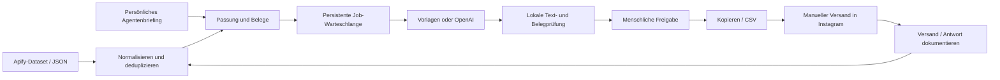

# Architektur

## Komponenten

- `engine.py`: reine Normalisierung, regelbasierte Auswahl, Belege, DE/EN-Vorlagen und konservative Textvalidierung.
- `store.py`: SQLite, atomare Zustandsübergänge, profil- und kampagnenbezogene Versionen, Job-Leases und Audit.
- `providers.py`: begrenzte HTTPS-Aufrufe an feste Apify-/OpenAI-Endpunkte. Authentifizierung im Header; keine Weiterleitung mit Zugangsdaten.
- `service.py`: Anwendungslogik, persönliche Agentenkonfiguration und Worker-Ausführung.
- `server.py`: authentifizierte JSON-API, feste statische Dateien, Hintergrundworker.
- `static/`: Browseroberfläche ohne Buildschritt oder Drittanbieter-Skripte.
- `__main__.py`: dieselben Vorgänge über die Kommandozeile.

## Speicher und Zustände

`OUTREACH_DATA_DIR` muss absolut sein. `agent.json` enthält die persönliche Konfiguration. SQLite enthält Profile, Kampagnen, kampagnenbezogene Entwürfe, Jobs und Audit-Ereignisse. Ein Kontakt wird über den normalisierten Handle identifiziert. Instagram-Umbenennungen werden damit **nicht** automatisch erkannt; für langfristige CRM-Integration wäre eine verifizierte stabile Account-ID zusätzlich erforderlich.

Profile: `pending → review → approved → sent → replied`. `suppressed` blockiert weitere Erstkontakte. Der API-Status `sent` bedeutet ausschließlich, dass eine Person den manuellen Versand bestätigt hat; kein Zustellnachweis von Instagram.

Jobs: `queued → running → completed | failed | cancelled`. Vergabe und Statuswechsel laufen in SQLite-Transaktionen (`BEGIN IMMEDIATE`). Kein Netzwerkaufruf hält eine Transaktion offen. Eine abgelaufene Lease kann wieder übernommen werden. Wiederholungen sind begrenzt; 429, 408, 5xx und Verbindungsfehler erhalten Wartezeit. Modellaufrufe können nach einem Prozessabbruch erneut Kosten verursachen, weil der Anbieteraufruf nicht Teil der lokalen Transaktion ist.

Änderungen an Profil oder Kampagne invalidieren offene Entwürfe und Freigaben. Ein verspätetes Worker-Ergebnis wird anhand der Versionen/Lease verworfen. Sperren und Kontaktstatus gelten innerhalb derselben Datenbank kampagnenübergreifend; die Ursprungskampagne und der tatsächlich freigegebene Text bleiben nachvollziehbar. Verschiedene Personen/Kunden verwenden getrennte Datenverzeichnisse.

SQLite ist für eine persönliche Instanz und begrenzte Importe ausgelegt. Für große Teams wären Postgres, eine separate Queue, Benutzerrollen, zentrale Überwachung und Mandantentrennung eine eigene Ausbaustufe. Keine SQLite-Datei gleichzeitig über mehrere Hosts oder ein Netzlaufwerk betreiben.

## HTTP-API

Alle `/api/*`-Aufrufe benötigen einen Bearer-Zugangsschlüssel. Schreibaufrufe verwenden JSON, maximal 2 MB. Fremde Browser-Origins werden abgewiesen; es gibt keine offenen CORS-Freigaben. Statische Dateien sind fest aufgelistet. Importdaten gelangen im Browser ausschließlich als Text in den DOM.

| Methode | Pfad | Inhalt |
|---|---|---|
| GET | `/health` | Minimaler Prozessstatus ohne Zugangsschlüssel |
| GET | `/api/state` | Agent, Profile, Jobs, Kennzahlen, verfügbare Textanbieter |
| POST | `/api/agent` | Vollständige validierte Kampagnenkonfiguration; gleiche ID behalten |
| POST | `/api/import` | `{ "profiles": [...] }`, 1–5.000 Profile |
| POST | `/api/import/apify` | `{ "dataset_id": "...", "max_items": 100 }` |
| POST | `/api/generate` | `{ "username": "optional", "provider": "template" }` |
| POST | `/api/profile/{username}/approve` | `{ "draft_id": "...", "text": "optional edited text" }` |
| POST | `/api/profile/{username}/sent` | `{}`; menschliche Versandbestätigung |
| POST | `/api/profile/{username}/replied` | `{}`; menschliche Antwortbestätigung |
| POST | `/api/profile/{username}/suppress` | `{}`; sperrt den Kontakt |
| GET | `/api/export` | CSV ausschließlich aktuell freigegebener Erstnachrichten |

CSV-Felder: `username`, `profile_url`, `text`, `status`. Potenzielle Tabellenformeln werden mit einem Apostroph entschärft. Exportiert heißt nicht gesendet. Der interne Audit-Verlauf ist über `Service.audit()` abrufbar.
